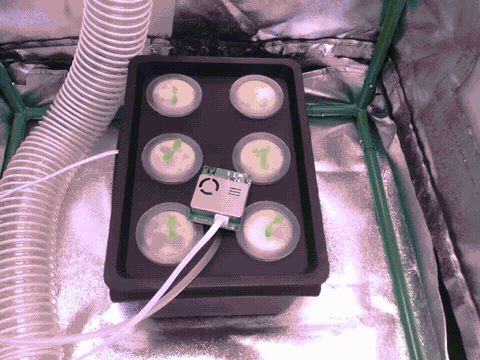
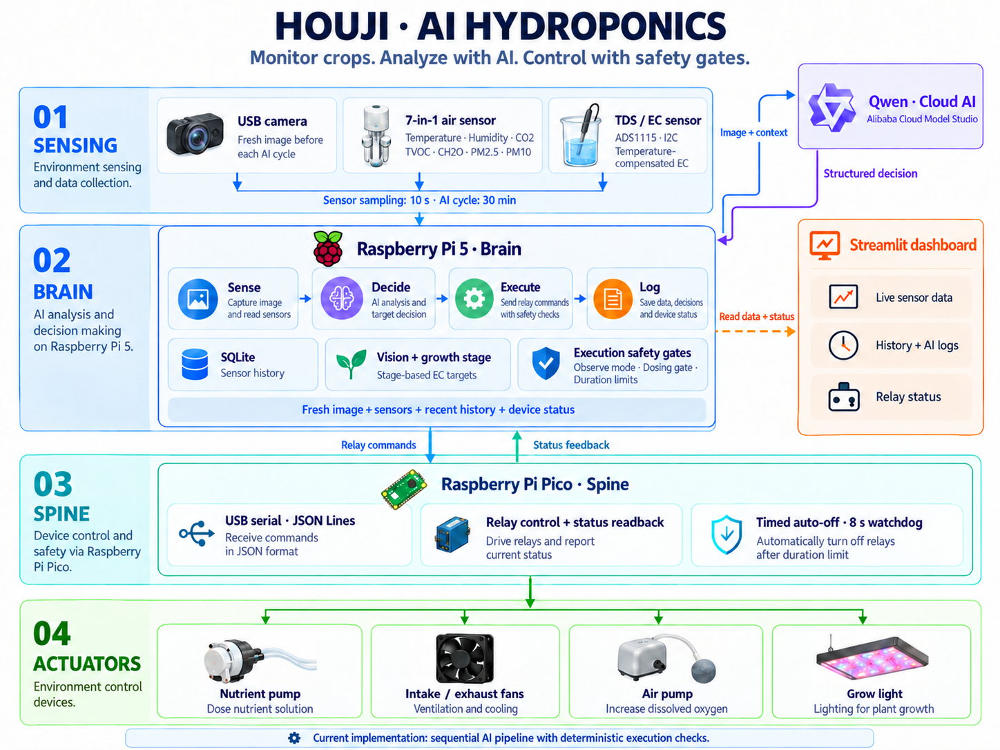

# Project Houji (后稷) 🌱

[简体中文](README.md) | **English**

> A hydroponic crop monitoring, AI analysis, and safety control project running inside a 50 × 50 × 100 cm enclosed grow tent. The currently documented deployment is for tomato seedlings; see `configs/instances/tomato-01.conf` for the actual operating configuration.


🖥️ **Local dashboard**: [`http://houji.local:8501`](http://houji.local:8501/)
🌐 **Public dashboard**: [`https://houji.cpolar.cn/`](https://houji.cpolar.cn/) (started alongside the dashboard by `houji-cpolar.service`)

## Growing journal

### Phase 1: Lettuce

[](docs/videos/phase-1-lettuce.mp4)

[Download the growing video (MP4, 2.7 MB)](docs/videos/phase-1-lettuce.mp4)

## System architecture



> This diagram is an overview. Refer to the current configuration and the descriptions below for actual sampling intervals and implemented capabilities. The dashboard screenshot is currently in Chinese.

## Core technology stack

| Layer | Technology |
|---|---|
| AI decisions | Sequential decision pipeline; direct image and text requests to Alibaba Cloud Model Studio (Bailian), using qwen3.7-plus |
| Sensor storage | SQLite (`houji.db`) |
| Camera | opencv-python; a fresh USB camera image is captured before each AI decision and compressed for the model |
| Environmental sensing | 7-in-1 serial sensor on `/dev/ttyAMA0`; currently sampled every 10 seconds |
| Water quality sensing | TDS/EC → ADS1115 I2C (0x48), μS/cm, with temperature compensation |
| Relay communication | pyserial · JSON Lines protocol (Pi 5 ↔ Pico) |
| Long-term memory | Not implemented; a solution will be selected when needed |
| Dashboard | Streamlit |

## Repository layout

```text
brain/              # Pi 5 controller (Python)
  ai_engine.py          AI decision pipeline (sense → decide → execute → log)
  sensor_logger.py      Sensor collection and SQLite storage (environment + water quality)
  sensor_reader.py      7-in-1 environmental sensor serial driver (17-byte frames)
  tds_reader.py         TDS/EC driver (ADS1115 I2C, cubic polynomial temperature compensation)
  serial_bridge.py      Pi 5 ↔ Pico relay communication (thread lock + automatic reconnection)
  camera.py             USB camera snapshots (OpenCV, 50-frame warm-up, 180° rotation correction)
  config.py             Global configuration (credentials loaded from .env)
  crop_profiles.py      Crop profiles, growth stages, and EC targets
  main.py               Main loop (configurable; currently 10s sensing / 30min snapshots + AI)
  data/                 Runtime data (ignored by Git)
    houji.db                Sensor history (SQLite)
    thought.log             Reasoning recorded for each AI decision
    houji.log               System logs
    hardware_status.json    Pico relay status readback
    snapshots/              Scheduled camera snapshots
spine/              # Pico actuator controller (MicroPython)
  main.py               Serial listener + JSON parsing + watchdog (8s)
  relay_driver.py       8-channel relay driver (Waveshare Pico-Relay-B, active-low)
dashboard/          # Dashboard (also used on Windows)
  Streamlit/app.py       Production dashboard (SQLite + logs + hardware readback)
test/               # Test scripts
  test_usb_camera.py     USB camera snapshot test
  test_tds.py            TDS/EC sensor reading test
  scan_sensor.py         I2C bus scan
  reset_relays.py        Reset all relays (emergency use)
docs/               # Project documentation
```

## Quick start

Using systemd is recommended to start sensor collection, AI processing, and the local dashboard together:

```bash
# Install and immediately start the systemd services.
# Prepare the Python environment and dependencies before running this command.
bash scripts/install_systemd.sh

# Check status, restart, or follow logs.
bash scripts/houji-service.sh status
bash scripts/houji-service.sh restart
bash scripts/houji-service.sh logs
```

Open `http://houji.local:8501` in your browser.

> [!CAUTION]
> `configs/instances/tomato-01.conf` is the configuration for the current physical deployment, not a safe template. Its checked-in values are `RUN_MODE=control`, `AI_ENABLED=true`, `NUTRIENT_DOSING_ENABLED=true`, and `CAMERA_FLASH_ENABLED=true`. These settings connect to the Pico, call an external model, and permit the nutrient pump to run when its conditions are met. For new hardware, maintenance, or unverified plumbing, first set `RUN_MODE=observe`, `AI_ENABLED=false`, and `NUTRIENT_DOSING_ENABLED=false`.

The current instance uses `SENSOR_INTERVAL=10`, `SNAPSHOT_INTERVAL=1800`, and `AI_DECISION_INTERVAL=1800` (seconds). Adjust these values in the instance configuration as needed. `scripts/install_systemd.sh` assumes the project is at `/home/houjiagent/houji` and that the virtual environment and dependencies are already prepared.

To run manually in the foreground:

```bash
set -a
source configs/instances/tomato-01.conf
set +a
source brain/venv/bin/activate
python brain/main.py

# Individual hardware checks may access the camera, sensors, production database, or relays.
python test/test_usb_camera.py  # USB camera snapshot
python test/test_tds.py         # TDS/EC sensor
python test/reset_relays.py     # Reset all relays (emergency)

# Install shared dependencies and start the dashboard.
pip install -r requirements.txt
cd dashboard/Streamlit
streamlit run app.py
```

> **Model connectivity**: The Pi 5 connects directly to Alibaba Cloud Model Studio through a workspace-specific host. The Qwen client explicitly disables environment proxies.

## Sensor data storage

`SENSOR_INTERVAL` controls the collection interval. The current instance samples every 10 seconds and writes to the `sensor_readings` table in `brain/data/houji.db`:

| Field | Source | Unit |
|---|---|---|
| `temp` / `humidity` | 7-in-1 serial sensor | °C / % |
| `co2` / `tvoc` / `ch2o` | 7-in-1 serial sensor | ppm |
| `pm25` / `pm10` | 7-in-1 serial sensor | μg/m³ |
| `ec` | TDS → ADS1115 I2C | μS/cm |
| `ph` | Not yet connected | — |

## Current AI capabilities and limits

- The main loop triggers the AI pipeline on a schedule: `sense → decide → execute → log`.
- Qwen receives a fresh image, sensor readings, the 10 most recent history records, and device status. Growth stage detection is automatic by default. The EC target is updated only after valid assessments from two different images agree; a missing image or an inconclusive assessment preserves the last confirmed stage. See [Vision control](docs/VISION_CONTROL.md) (Chinese).
- Long-term memory and autonomous tool use are not implemented; solutions will be selected when needed.
- `RUN_MODE=observe` is the master execution gate. In observation mode, the execution layer does not connect to the Pico.

## AI policies and deterministic safety limits

| Device | relay_id | Policy | Current execution-layer constraints |
|---|---:|---|---|
| Nutrient peristaltic pump | 1 | Dose when EC falls below the lower limit for the stage effective in this cycle, and run aeration alongside dosing | Requires `NUTRIENT_DOSING_ENABLED` and a valid EC reading below the lower limit; an activation is forced to 10 seconds. Coordinated aeration still depends on model actions |
| Intake / exhaust fans | 2 / 3 | Ventilate together for 120 seconds when CO₂ > 1200 ppm or temperature > 28°C; at night, ventilate only for severe excursions | Maximum action duration: 300 seconds. Thresholds, coordination, and nighttime rules are primarily prompt constraints and are not yet fully enforced by the execution layer |
| Air pump | 7 | Run for 60 seconds at each daytime decision; no routine nighttime activation | General duration limit: 300 seconds. Day/night rules and the prohibition on continuous operation are not yet fully enforced by the execution layer |
| Grow light | 8 | Stay on from 06:00 to 22:00; off at night | `duration_seconds=0` means continuous operation; the schedule currently depends on model policy |

The Pico turns off timed activations locally and uses an 8-second watchdog to reset itself if its program hangs. This does not provide a fail-safe shutdown on loss of communication with the Pi. Continuous actions require an additional heartbeat or timeout policy.

## Documentation

The detailed project documents are currently in Chinese:

- [Project brief](docs/PROJECT_BRIEF.md)
- [AI engine design](docs/AI_ENGINE_DESIGN.md)
- [Vision control](docs/VISION_CONTROL.md)

## Progress

- ✅ Phase 1: Complete hardware chain (environmental sensor + TDS/EC + USB camera + relays)
- ✅ Phase 2: Alibaba Cloud Model Studio qwen3.7-plus multimodal decision loop, including deterministic nutrient dosing gates and device policy prompts
- ✅ Phase 3: Streamlit live dashboard + Pico hardware status readback + automatic recovery from serial port changes
- Further capabilities will follow actual growing needs; long-term memory and autonomous tool frameworks are deferred until needed.

---
*A tribute to Sol mode 🤖*
