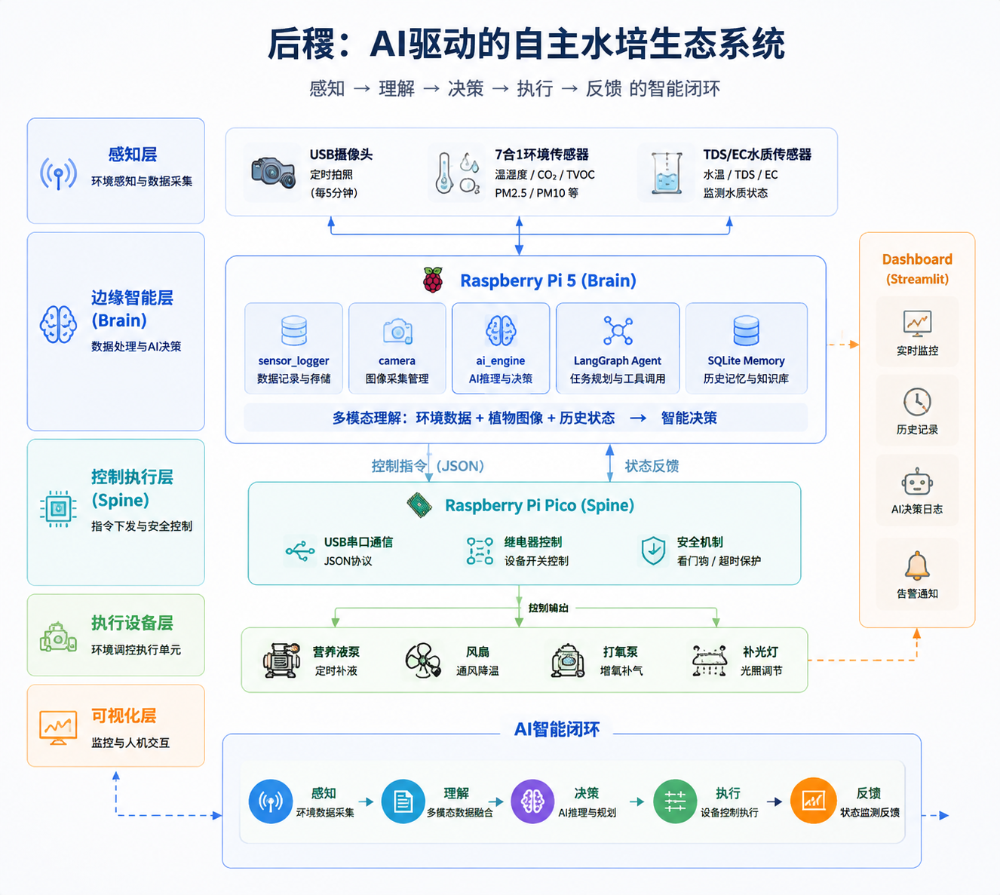

# 后稷 (Project Houji) 🌱

> 一个在 50×50×100cm 密闭帐篷内运行的水培作物感知、AI 分析与安全控制项目。当前部署实例为番茄育苗期，实际运行模式以 `configs/instances/tomato-01.conf` 为准。


🖥️ **局域网看板**：[`http://houji.local:8501`](http://houji.local:8501/)
🌐 **公网看板**：[`https://houji.cpolar.cn/`](https://houji.cpolar.cn/)（由 `houji-cpolar.service` 随看板启动）

## 种植记录

### 第一期：生菜

[](docs/videos/phase-1-lettuce.mp4)

[下载高清种植视频（MP4，2.7 MB）](docs/videos/phase-1-lettuce.mp4)

## 系统架构



> 架构示意图；实际采样周期和已实现能力以当前配置及下文说明为准。


## 核心技术栈

| 层 | 技术 |
|---|---|
| AI 决策 | 顺序决策管线；阿里云百炼 qwen3.7-plus 图片与文本直连 |
| 传感数据 | SQLite (`houji.db`) |
| 摄像头 | opencv-python（USB 摄像头，每次 AI 决策前拍摄新照片，并压缩发送给模型） |
| 环境传感 | 7合1串口传感器，`/dev/ttyAMA0`；当前每 10 秒采集 |
| 水质传感 | TDS/EC → ADS1115 I2C (0x48)，μS/cm，温度补偿 |
| 继电器通信 | pyserial · JSON Lines 协议 (Pi5 ↔ Pico) |
| 长期记忆 | 尚未实现；有实际需求时再选方案 |
| 看板 | Streamlit |

## 目录结构

```
brain/              # Pi 5 主控（Python）
  ai_engine.py          AI 决策管线（sense → decide → execute → log）
  sensor_logger.py      传感器采集 + SQLite 存储（整合环境+水质数据）
  sensor_reader.py      7合1环境传感器串口驱动（17字节帧协议）
  tds_reader.py         TDS/EC 传感器驱动（ADS1115 I2C，温度补偿三次多项式）
  serial_bridge.py      Pi5 ↔ Pico 继电器通信（线程锁 + 自动重连）
  camera.py             USB 摄像头快照（OpenCV，预热50帧，180°翻转修正）
  config.py             全局配置（从 .env 加载密钥）
  crop_profiles.py      作物、阶段与 EC 目标配置
  main.py               主循环（间隔可配置；当前10s采集 / 30min快照+AI决策）
  data/                 运行时数据（Git 忽略）
    houji.db                传感器历史（SQLite）
    thought.log             AI 每次决策的推理过程
    houji.log               系统运行日志
    hardware_status.json    Pico 继电器状态回读
    snapshots/              摄像头定时快照
spine/              # Pico 执行器（MicroPython）
  main.py               串口监听 + JSON 解析 + 看门狗（8s）
  relay_driver.py       8路继电器驱动（Waveshare Pico-Relay-B，低电平触发）
dashboard/          # Windows 看板
  Streamlit/app.py      当前生产数据看板（SQLite + 日志 + 硬件回读）
test/               # 测试脚本
  test_usb_camera.py    USB 摄像头快照测试
  test_tds.py           TDS/EC 传感器读数测试
  scan_sensor.py        I2C 总线扫描
  reset_relays.py       全部继电器复位（紧急用）
docs/               # 项目文档
```

## 快速开始

推荐使用 systemd，一次启动采集/AI 与本地网页：

```bash
# 安装 systemd 服务并立即启动；运行前需先准备好 Python 环境和依赖
bash scripts/install_systemd.sh

# 查看状态、重启或跟踪日志
bash scripts/houji-service.sh status
bash scripts/houji-service.sh restart
bash scripts/houji-service.sh logs
```

浏览器访问：`http://houji.local:8501`

> [!CAUTION]
> `configs/instances/tomato-01.conf` 是当前现场实例配置，不是安全模板。仓库当前值为 `RUN_MODE=control`、`AI_ENABLED=true`、`NUTRIENT_DOSING_ENABLED=true`、`CAMERA_FLASH_ENABLED=true`，会连接 Pico、调用外部模型并允许满足条件时启动营养液泵。新设备部署、检修或管路未验收时，应先改为 `RUN_MODE=observe`、`AI_ENABLED=false`、`NUTRIENT_DOSING_ENABLED=false`。

当前实例的 `SENSOR_INTERVAL=10`，`SNAPSHOT_INTERVAL=1800`，`AI_DECISION_INTERVAL=1800`。这些值都可在实例配置中调整。`scripts/install_systemd.sh` 假定项目位于 `/home/houjiagent/houji`，且虚拟环境与依赖已提前准备完成。

手工前台运行：

```bash
set -a
source configs/instances/tomato-01.conf
set +a
source brain/venv/bin/activate
python brain/main.py

# 单模块实机验证（可能访问摄像头、传感器、生产数据库或继电器）
python test/test_usb_camera.py  # USB 摄像头快照
python test/test_tds.py         # TDS/EC 传感器
python test/reset_relays.py     # 全部继电器复位（紧急）

# 安装统一依赖并启动看板
pip install -r requirements.txt
cd dashboard/Streamlit
streamlit run app.py
```

> **模型网络**：Pi5 通过业务空间专属 Host 直连阿里云百炼，Qwen 客户端显式禁用环境代理。

## 传感器数据入库

采集周期由 `SENSOR_INTERVAL` 控制；当前实例每 10 秒采集一次，写入 `brain/data/houji.db` → `sensor_readings` 表：

| 字段 | 来源 | 单位 |
|---|---|---|
| `temp` / `humidity` | 7合1串口 | °C / % |
| `co2` / `tvoc` / `ch2o` | 7合1串口 | ppm |
| `pm25` / `pm10` | 7合1串口 | μg/m³ |
| `ec` | TDS → ADS1115 I2C | μS/cm |
| `ph` | 待接入 | — |

## 当前 AI 能力边界

- AI 管线按 `sense → decide → execute → log` 顺序运行，由主循环定时触发。
- Qwen 接收本轮新鲜照片、传感器、最近 10 条历史记录及设备状态。默认自动判断生长阶段，两次不同图片的有效判断一致后更新 EC 目标；缺图或无法判断时保留上次确认阶段。详见 docs/VISION_CONTROL.md。
- 长期记忆和自主工具调用尚未实现；有实际需求时再选择方案。
- `RUN_MODE=observe` 是执行总闸；处于观察模式时，执行层不会连接 Pico。

## AI 策略与确定性安全边界

| 设备 | relay_id | 策略 | 当前执行层硬约束 |
|---|---:|---|---|
| 营养液蠕动泵 | 1 | EC 低于本轮生效阶段下限时补液，并联动打氧 | 必须启用 `NUTRIENT_DOSING_ENABLED`、EC 有效且低于下限；开启时强制 10 秒。打氧联动目前仍依赖模型动作 |
| 进/排气风扇 | 2 / 3 | CO₂>1200ppm 或温度>28°C 时联动通风 120 秒；夜间仅严重超标时通风 | 动作时长上限 300 秒；阈值、联动和夜间规则目前主要由提示词约束，尚未在执行层完全强制 |
| 打氧泵 | 7 | 白天每次决策开启 60 秒，夜间禁止常规开启 | 通用时长上限 300 秒；昼夜规则和禁止持续开启目前尚未在执行层完全强制 |
| 补光灯 | 8 | 6:00~22:00 常亮，夜间关闭 | `duration_seconds=0` 表示持续；时间计划目前由模型策略决定 |

Pico 会为带时长的开启动作执行脱机自动关闭，并在自身程序卡死时由 8 秒看门狗复位；这不等同于 Pi 通信失联熔断，持续动作需要额外的心跳或超时策略。

## 文档

- [项目总纲](docs/PROJECT_BRIEF.md)
- [AI 引擎设计](docs/AI_ENGINE_DESIGN.md)

## 阶段进展

- ✅ Phase 1：硬件全链路打通（环境传感器 + TDS/EC + USB摄像头 + 继电器）
- ✅ Phase 2：阿里云百炼 qwen3.7-plus 多模态决策闭环（含营养液确定性门控与设备策略提示）
- ✅ Phase 3：Streamlit 实时看板 + Pico 硬件状态回读 + 串口漂移自愈
- 后续能力按实际种植需求增加，不提前引入长期记忆或自主工具框架。

---
*致敬 Sol 模式 🤖*
