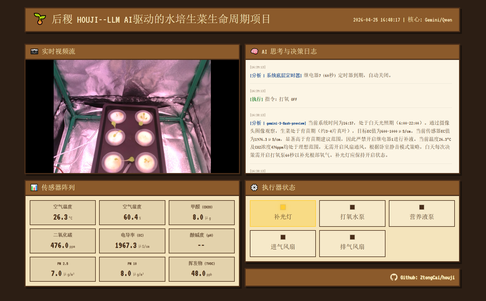

# 后稷 (Project Houji) 🌱

> 一个在 50×50×100cm 密闭帐篷内，由 Gemini AI 全程接管的水培生菜生命周期项目。



🔗 **后稷 AI 全局监控看板 (实况)**: [https://d0b0db6.r7.vip.cpolar.cn](https://d0b0db6.r7.vip.cpolar.cn)

## 系统架构

```
[USB 摄像头]    ──┐
[7合1环境传感器]──┤
[TDS/EC ADS1115]──┼──▶  [Pi 5 (brain)] ── USB ──▶ [Pico (spine)] ──▶ 继电器板
  (I2C 0x48)       │                      Samba ▼                    ├── 营养液蠕动泵 (relay 1, 12V)
                   │                  [Windows 看板]                  ├── 进气风扇 (relay 2, 12V)
                   │                                                  ├── 出气风扇 (relay 3, 12V)
                   │                                                  ├── 打氧泵 (relay 7, 220V)
                   │                                                  └── 补光灯 (relay 8, 220V)
```

## 核心技术栈

| 层 | 技术 |
|---|---|
| AI 决策 | LangGraph + Gemini Flash (多模态) |
| 传感数据 | SQLite (`houji.db`) |
| 摄像头 | opencv-python (USB 摄像头, 每5分钟快照) |
| 环境传感 | 7合1串口传感器，`/dev/ttyAMA0`，每60秒采集 |
| 水质传感 | TDS/EC → ADS1115 I2C (0x48)，μS/cm，温度补偿 |
| 继电器通信 | pyserial · JSON Lines 协议 (Pi5 ↔ Pico) |
| 长期记忆 | LightRAG (Phase 3，待接入) |
| 看板 | Streamlit (`dashboard/Streamlit/app.py`) |

## 目录结构

```
brain/              # Pi 5 主控（Python）
  ai_engine.py          LangGraph 决策图（sense → decide → execute → log）
  sensor_logger.py      传感器采集 + SQLite 存储（整合环境+水质数据）
  sensor_reader.py      7合1环境传感器串口驱动（17字节帧协议）
  tds_reader.py         TDS/EC 传感器驱动（ADS1115 I2C，温度补偿三次多项式）
  serial_bridge.py      Pi5 ↔ Pico 继电器通信（线程锁 + 自动重连）
  camera.py             USB 摄像头快照（OpenCV，预热10帧，180°翻转修正）
  config.py             全局配置（从 .env 加载密钥）
  main.py               主循环（60s 采集 / 5min 快照+AI决策）
  rag_memory.py         LightRAG 预留接口（Phase 3）
  data/                 运行时数据（Git 忽略）
    houji.db                传感器历史（SQLite）
    thought.log             AI 每次决策的推理过程
    houji.log               系统运行日志
    snapshots/              摄像头定时快照
spine/              # Pico 执行器（MicroPython）
  main.py               串口监听 + JSON 解析 + 看门狗（8s）
  relay_driver.py       8路继电器驱动（Waveshare Pico-Relay-B，低电平触发）
dashboard/          # Windows 看板
  Streamlit/app.py      Streamlit 数据看板
test/               # 测试脚本
  test_usb_camera.py    USB 摄像头快照测试
  test_tds.py           TDS/EC 传感器读数测试
  test_relay.py         继电器通断测试
  test_ai_engine.py     AI 决策闭环测试（流式输出）
  scan_sensor.py        I2C 总线扫描
  reset_relays.py       全部继电器复位（紧急用）
docs/               # 项目文档
```

## 快速开始

```bash
# Pi5 - 激活环境并启动
source brain/venv/bin/activate
python brain/main.py

# 单模块验证
python test/test_usb_camera.py  # USB 摄像头快照
python test/test_tds.py         # TDS/EC 传感器
python test/test_ai_engine.py   # AI 决策闭环（流式）
python test/reset_relays.py     # 全部继电器复位（紧急）

# Windows 看板
cd dashboard/Streamlit && pip install -r requirements.txt
streamlit run app.py
```

> ⚠️ **代理配置**：Pi5 需通过局域网代理访问 Gemini API（已写入 `brain/venv/bin/activate`）

## 传感器数据入库

每 60 秒采集一次，写入 `brain/data/houji.db` → `sensor_readings` 表：

| 字段 | 来源 | 单位 |
|---|---|---|
| `temp` / `humidity` | 7合1串口 | °C / % |
| `co2` / `tvoc` / `ch2o` | 7合1串口 | ppm |
| `pm25` / `pm10` | 7合1串口 | μg/m³ |
| `ec` | TDS → ADS1115 I2C | μS/cm |
| `ph` | 待接入 | — |

## AI 控制策略约束

| 设备 | relay_id | 电压 | 控制规则 |
|---|---|---|---|
| 营养液蠕动泵 | 1 | 12V | 按生长阶段补液，固定 2s；硬性截断 ≤5s；强制联动打氧 |
| 进气风扇 | 2 | 12V | CO2>1200ppm 或 温度>28°C 才开；与排气扇联动；固定 120s |
| 出气风扇 | 3 | 12V | 与进气扇强制联动；固定 120s；夜间禁常规通风 |
| 打氧泵 | 7 | 220V | 夜间禁常规开启；白天每小时前5分钟开60s；硬性截断 ≤300s |
| 补光灯 | 8 | 220V | 白天(6:00~22:00)常亮，夜间关闭；duration_seconds=0 持续 |

## 文档

- [项目总纲](docs/PROJECT_BRIEF.md)
- [AI 引擎设计](docs/AI_ENGINE_DESIGN.md)
- [Gemini 可用模型](docs/GEMINI_MODELS.md)

## 阶段进展

- ✅ Phase 1：硬件全链路打通（环境传感器 + TDS/EC + USB摄像头 + 继电器）
- ✅ Phase 2：LangGraph AI 决策双脑闭环（Gemini 核心 + 硅基流动 Qwen 防崩溃退路，含防烧苗、光照风扇联动策略）
- ✅ Phase 3：工业级大屏前端构建（Streamlit Bento UI 重构 + JS 异步响应注入 + 串口电磁抗干扰漂移自愈系统）
- 🔲 Phase 4：LightRAG 长期记忆（水培知识库 + 生长日记 + 异常条件分支路由）
- 🔲 Phase 5：ReAct Tool Use，突破定时轮询束缚，AI 升级为完全自主智能体

---
*致敬 Sol 模式 🤖*
